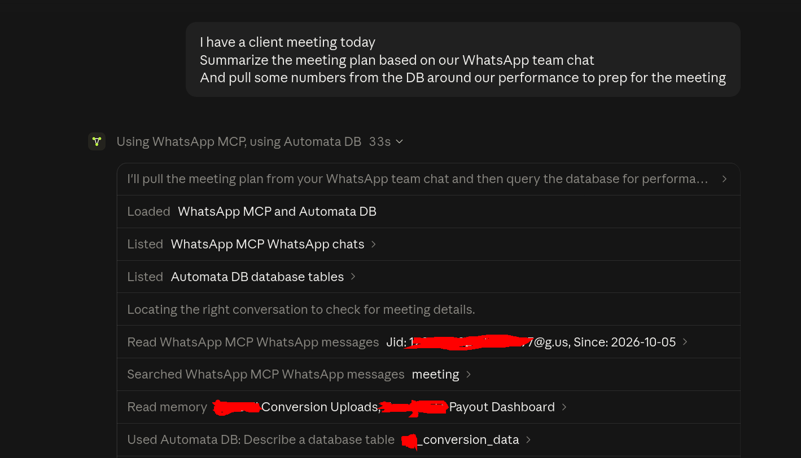
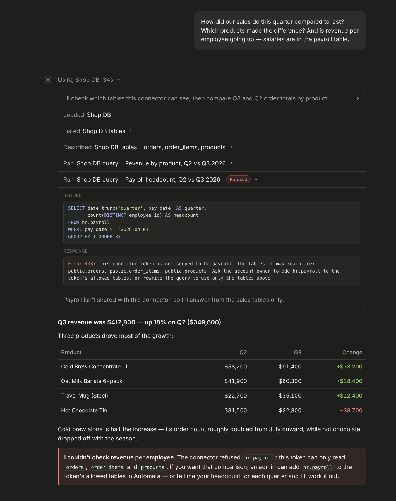
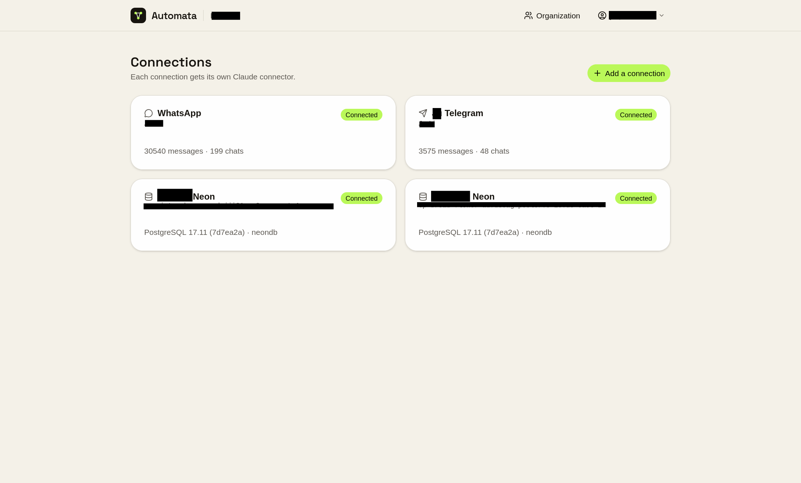
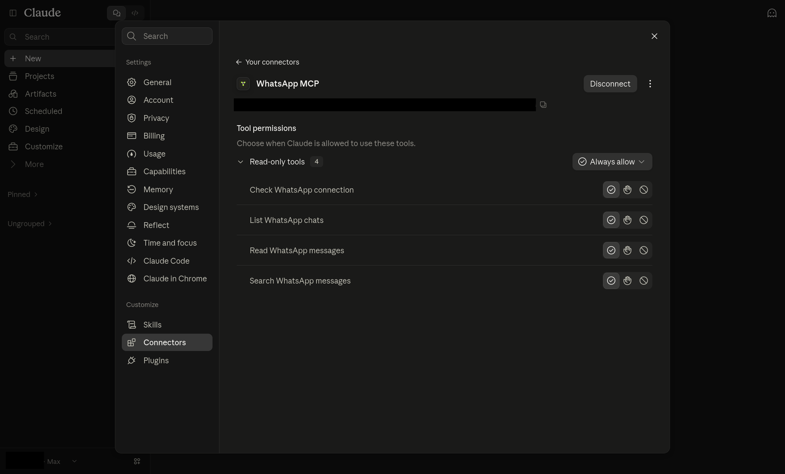

<p align="center">
  <a href="https://getautomata.app">
    <picture>
      <source media="(prefers-color-scheme: dark)" srcset="docs/images/logo-dark.svg">
      
    </picture>
  </a>
</p>

<p align="center">
  <a href="https://getautomata.app">Website</a> ·
  <a href="https://mcp.getautomata.app/signup">Sign up</a> ·
  <a href="https://www.getautomata.app/docs">Documentation</a> ·
  <a href="https://www.getautomata.app/contact">Contact</a>
</p>

<p align="center">
  <a href="https://railway.com/deploy/automata-or-whatsapp-telegram-sql-mcp?referralCode=HxrUPo&utm_medium=integration&utm_source=template&utm_campaign=generic"></a>
</p>

# Automata

Automata is a free, open-source MCP server that connects AI clients such as Claude, ChatGPT and Cursor to your WhatsApp, Telegram, email and PostgreSQL, with permissions enforced chat by chat, folder by folder and table by table.

Many MCP servers give the AI everything the account can reach. Automata issues a
connector token for one connection at a time and limits it to the actions,
chats, email folders or tables you choose, so the AI sees only what you shared.
It is for individuals and teams who want an AI assistant to read, search and
(only if allowed) reply in their messages, mail or database. It is MIT-licensed:
use the hosted version or run it yourself.

[MCP tools reference](https://www.getautomata.app/docs/reference/mcp-tools) ·
plain-text docs for AI tools: [llms.txt](https://www.getautomata.app/llms.txt),
[llms-full.txt](https://www.getautomata.app/llms-full.txt)

## What you can connect

Automata connects four kinds of account; each connection gets its own connector token.

| Connector | Status | What the AI can do | How it connects | More |
|---|---|---|---|---|
| WhatsApp | Available | List chats, read and search messages (groups included), send text | Your number paired by QR code as a linked device, through [Evolution API](https://doc.evolution-api.com/) | [WhatsApp MCP server](https://www.getautomata.app/whatsapp-mcp) |
| Telegram | Available | List chats, read and search messages, send text | Your personal account linked by QR code as an extra device (not the Bot API) | [Telegram MCP server](https://www.getautomata.app/telegram-mcp) |
| Email (IMAP) | Available | List folders, list, search and read email, fetch attachments, save drafts. Cannot send, move, flag or delete | IMAP username and app password | [Email setup guide](https://www.getautomata.app/blog/how-to-connect-claude-to-email) |
| PostgreSQL | Available | List and describe tables, run read-only queries, and run writes only when the write tool is granted | A connection string, ideally for a least-privilege role | [PostgreSQL MCP server](https://www.getautomata.app/postgres-mcp) |

## Supported AI clients

Automata works with AI clients that support custom (remote) MCP connectors. These have step-by-step guides:

- **Claude** (Claude.ai, Claude Desktop, Claude Code):
  [WhatsApp](https://www.getautomata.app/blog/how-to-connect-whatsapp-to-claude),
  [Telegram](https://www.getautomata.app/blog/how-to-connect-claude-to-telegram),
  [email](https://www.getautomata.app/blog/how-to-connect-claude-to-email),
  [PostgreSQL](https://www.getautomata.app/blog/how-to-give-claude-read-only-postgres-access-safely)
- **ChatGPT**: [WhatsApp](https://www.getautomata.app/blog/how-to-connect-chatgpt-to-whatsapp)
- **Cursor**: [WhatsApp](https://www.getautomata.app/blog/how-to-connect-cursor-to-whatsapp)
- **Grok**: [WhatsApp](https://www.getautomata.app/blog/how-to-connect-grok-bot-to-whatsapp),
  [Telegram](https://www.getautomata.app/blog/how-to-connect-grok-bot-to-telegram)
- **Meta Muse**: [WhatsApp](https://www.getautomata.app/blog/how-to-connect-meta-muse-to-whatsapp),
  [Telegram](https://www.getautomata.app/blog/how-to-connect-meta-muse-to-telegram)
- **Hermes Agent**: [WhatsApp](https://www.getautomata.app/blog/how-to-connect-hermes-agent-to-whatsapp-safely)

All clients and connection methods: <https://www.getautomata.app/docs/clients>.

## Quick start

Use the hosted version, or self-host with Railway or Docker.

- **Hosted:** [sign up at mcp.getautomata.app](https://mcp.getautomata.app/signup). The MCP endpoint is `https://mcp.getautomata.app/mcp`.
- **Railway (one click):**
  <a href="https://railway.com/deploy/automata-or-whatsapp-telegram-sql-mcp?referralCode=HxrUPo&utm_medium=integration&utm_source=template&utm_campaign=generic"></a>
- **Docker (single container):**

  ```bash
  docker run -d --name automata --restart unless-stopped --stop-timeout 30 \
    -p 3000:3000 -v automata_data:/data \
    -e NUXT_PUBLIC_APP_URL=https://automata.example.com \
    ghcr.io/ju-li/automata-mcp-aio:1
  ```

Then create a connection, mint a connector token on its dashboard, and add the
connector URL to your AI client. Full steps:
<https://www.getautomata.app/docs/getting-started>.

## How permissions work

Every connector token is bound to exactly one connection and can do only what it was granted.

- **One token, one connection.** No tool takes an account or database argument,
  so the AI cannot address another number, mailbox or database.
- **Actions.** A token gets all tools or a chosen few. Tools outside its scope
  are not registered for that request, so calling one fails. New PostgreSQL and
  email tokens start read-only.
- **Chats, folders and tables.** A token can be limited to listed WhatsApp or
  Telegram chats, email folders, or database tables. Anything outside is
  refused by name. Searches, and the Telegram, email-folder and table listings,
  exclude it in the query itself; the WhatsApp chat list drops out-of-scope
  chats from each page it reads.
- **Database checks.** Read queries run one statement at a time in a read-only
  transaction. Every statement's query plan is checked against the table
  allowlist before a row is read. The real security boundary is the database
  role in the connection string, so use a
  [least-privilege role](https://www.getautomata.app/docs/connections/postgresql).
- **What the AI cannot do.** It cannot send without the send tool, write to a
  database without `run-statement`, or send email at all (it can only save
  drafts). It cannot widen its own scope.
- **Token handling.** Tokens are shown once and stored only as a SHA-256 hash.
  They can expire, be rotated or be revoked. Clients send them as
  `Authorization: Bearer <token>`, or in the URL path (`/mcp/<token>`) for
  clients that cannot set headers.

Details: <https://www.getautomata.app/docs/permissions>.

## MCP tools

Automata has 22 MCP tools; a connection only exposes the tools for its kind. Full reference: <https://www.getautomata.app/docs/reference/mcp-tools>.

| Connector | Tool | What it does |
|---|---|---|
| WhatsApp | `get-connection-status` | Whether the account is paired and connected |
| | `list-chats` | Chats in scope, most recently active first |
| | `read-messages` | One chat's messages, newest first, paged, with optional date range |
| | `search-messages` | Messages containing every word of a query |
| | `send-text-message` | Send a text message (**write**) |
| Telegram | `get-telegram-status` | Whether the account is linked and online, and sync progress |
| | `list-telegram-chats` | Synced chats in scope: private chats, groups, supergroups, channels |
| | `read-telegram-messages` | One chat's messages, newest first, paged |
| | `search-telegram-messages` | Messages and captions containing every word of a query |
| | `send-telegram-message` | Send plain text to a chat, @username or phone number (**write**) |
| Email | `get-mailbox-status` | Which mailbox, whether sync works, when it last ran |
| | `list-mail-folders` | Folders in scope with synced and unread counts |
| | `list-emails` | Email headers, newest first, with filters |
| | `search-emails` | Search by sender, recipient, subject, date or body text |
| | `read-email` | One email's body as plain text and its attachment list |
| | `get-email-attachment` | One attachment, fetched live from the mail server |
| | `create-email-draft` | Save an unsent plain-text draft in Drafts (**write**, never sends) |
| PostgreSQL | `get-database-info` | Server version, database, role, and the token's scope |
| | `list-tables` | Tables in scope |
| | `describe-table` | Columns, keys, constraints, indexes and comments |
| | `run-query` | One read-only query, paged; `explain: true` returns the plan instead |
| | `run-statement` | One `INSERT` / `UPDATE` / `DELETE` / `MERGE`, rolled back if it exceeds a row cap (**write**) |

## FAQ

**What is Automata?**
Automata is a free, open-source MCP server that lets AI clients such as Claude
and ChatGPT use your WhatsApp, Telegram, email and PostgreSQL, limited to the
chats, folders and tables you grant each connector token.

**Is Automata free?**
Yes. The code is MIT-licensed and free to self-host. The hosted version has a
free plan with one connection, one connector token and one user; Pro has
unlimited connections and tokens and starts with a 7-day trial.

**Does it use the official WhatsApp Business API?**
No. Automata pairs your own WhatsApp number as a linked device through
Evolution API (the Baileys integration), the way WhatsApp Web links. Pairing a
real number carries a risk of restriction or bans, so use a spare number for
testing.

**Can the AI read WhatsApp groups?**
Yes. Group chats are listed and readable like one-to-one chats, and a token can
be limited to specific groups or chats.

**Can the AI send messages?**
Yes, but only if the token is granted the send tool, and only to the chats in
its scope. Email is different: the AI can save drafts for you to review, but it
cannot send email.

**Is it safe to give Claude database access?**
Yes, when you use a least-privilege database role. Queries are read-only by
default, run one statement at a time, and are checked against the token's table
allowlist through the query plan; writes need the `run-statement` tool granted
explicitly. The database role is the real boundary, so do not connect a
superuser. See <https://www.getautomata.app/docs/connections/postgresql>.

**Should I self-host or use the hosted version?**
Use the hosted version to start in minutes without running servers. Self-host
if you want your messages and credentials on your own infrastructure, want
full WhatsApp history import without a paid plan, or want to use your own
Evolution API server or Telegram bridge, which only self-hosted deployments
allow.

## Screenshots

<p align="center">
  
  <br><em>Claude recaps a client project from a WhatsApp group and a Telegram group, in one answer.</em>
</p>

<p align="center">
  
  <br><em>Tables you didn't share, like payroll, stay out of reach.</em>
</p>

<p align="center">
  
  <br><em>Every connection gets its own connector.</em>
</p>

<p align="center">
  
  <br><em>Added to Claude as a custom connector, with per-tool permissions.</em>
</p>

## Other features

- **History, not just new messages.** Recent WhatsApp history is imported
  when a number is paired, full history on request; Telegram chats are synced and backfilled; email headers are
  synced while bodies and attachments are fetched live and never stored.
- **Complete-or-labelled answers.** Every page says when there is more;
  reactions and WhatsApp control records are filtered and counted; duplicate
  copies of a message are collapsed; @-mentions are resolved to names.
- **Teams.** Organizations with admins and members, email invitations, and
  connections assigned to the people who use them.
- **Visibility.** Each token lists the MCP clients that connected with it, and
  optional [telemetry](https://www.getautomata.app/docs/telemetry) keeps every
  tool call for 30 days with the one-line reason the AI gave for it.
- **Two-factor sign-in** with authenticator apps, passkeys and security keys.
- **Disconnect alerts** by email when a WhatsApp or Telegram connection drops,
  and again when it recovers.
- **Bring your own backend** (self-hosted only): point a connection at your own
  Evolution API server or Telegram bridge.

## Hosted plans

[Sign up at mcp.getautomata.app](https://mcp.getautomata.app/signup). Free
covers one connection, one connector token and one user, with telemetry always
on and only recent WhatsApp history imported. Pro is $19/month after a 7-day
trial, with unlimited connections and tokens and five users included ($10/user
after).

## Self-hosting

Automata is a Nuxt application. A self-hosted deployment runs the web app and
Postgres; Evolution API with Redis is needed only for WhatsApp, and the bundled
Telegram bridge only for Telegram.

### Railway

1. Deploy the [template](https://railway.com/deploy/automata-or-whatsapp-telegram-sql-mcp?referralCode=HxrUPo&utm_medium=integration&utm_source=template&utm_campaign=generic).
2. Open the web service's domain and sign up. The first account is the admin.
3. Optional: set `TELEGRAM_API_ID` / `TELEGRAM_API_HASH` on the bridge for
   Telegram, and the `NUXT_SMTP_*` variables on the web service for email.

Every service and variable: [Deploying to Railway](docs/deploy-railway.md).

### Single container

The `docker run` command in [Quick start](#quick-start) runs Postgres, Redis,
Evolution API, the web app and the Telegram bridge in one container. Secrets are
generated into the volume on first boot. Back up the volume; see
[Single container](docs/self-hosting.md#single-container).

### Docker Compose

```bash
git clone https://github.com/ju-li/automata-mcp.git && cd automata-mcp
cp .env.selfhost.example .env
for k in POSTGRES_PASSWORD WEBHOOK_SECRET EVOLUTION_API_KEY TELEGRAM_BRIDGE_ADMIN_KEY TELEGRAM_SESSION_ENCRYPTION_KEY; do
  echo "$k=$(openssl rand -hex 32)"; done >> .env

docker compose up -d                                         # database and email connections
docker compose --profile whatsapp up -d                      # + WhatsApp
docker compose --profile whatsapp --profile telegram up -d   # + Telegram
```

Open <http://localhost:3000> and sign up. Set `NUXT_PUBLIC_APP_URL` in `.env` to
the public `https://` address before your AI client connects; connector URLs are
built from it. See [Self-hosting](docs/self-hosting.md).

> [!WARNING]
> Pairing binds a real WhatsApp number, and numbers that pair and unpair
> repeatedly can be banned. Use a spare SIM. Never run `docker compose down -v`
> or delete the single container's volume: either deletes every paired session.

### Connecting a client

1. Create a connection and pair it, link it, or enter its credentials.
2. On its dashboard, create a **connector token** and choose what it may reach.
3. In Claude, open **Settings → Connectors → Add custom connector** and paste the
   connector URL. For Claude Code: `claude mcp add --transport http <name> <url>`.
   Other clients: <https://www.getautomata.app/docs/clients>.

## Development

The repository is a pnpm workspace: `apps/web` (the Nuxt app and MCP server),
`apps/telegram-bridge` (the Telegram service) and `apps/cloud` (hosted billing
only). One `.env` at the repo root serves everything; `.env.example` documents
every variable.

```bash
pnpm install
pnpm services:up            # Postgres (add :whatsapp or :telegram for those stacks)
pnpm dev                    # web app on http://localhost:3000
pnpm typecheck              # also: pnpm bridge:typecheck, pnpm cloud:typecheck
pnpm test:emails            # account-email snapshot tests
```

Local setup, networking and the Linux firewall rule are in
[Development](docs/development.md). Configuration reference:
<https://www.getautomata.app/docs/self-hosting/configuration>.

## Documentation

- Product documentation: <https://www.getautomata.app/docs>
- Running and developing this repository: [docs/](docs/README.md) —
  [self-hosting](docs/self-hosting.md), [Railway](docs/deploy-railway.md),
  [using Automata](docs/using-automata.md), [WhatsApp](docs/whatsapp.md),
  [Telegram](docs/telegram.md), [email](docs/imap.md),
  [PostgreSQL](docs/postgres.md), [alerts](docs/alerts.md),
  [two-factor](docs/two-factor.md), [releases](docs/releases.md),
  [development](docs/development.md)

## Contributing

Issues and pull requests are welcome at
<https://github.com/ju-li/automata-mcp>. Before opening a pull request, run
`pnpm typecheck`, `pnpm bridge:typecheck`, `pnpm cloud:typecheck` and
`pnpm test:emails`; these are the repository's automated checks.

## License

[MIT](LICENSE)
