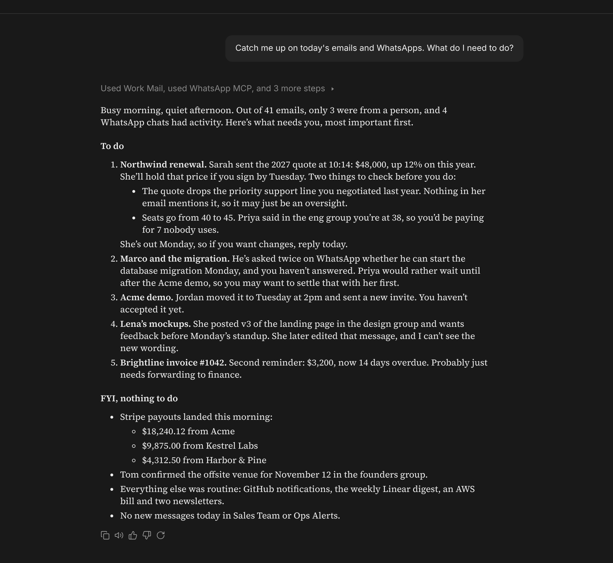
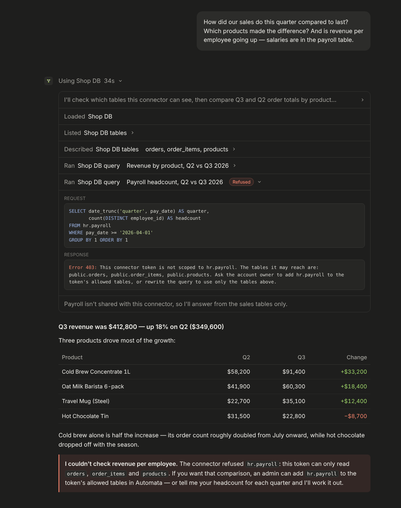
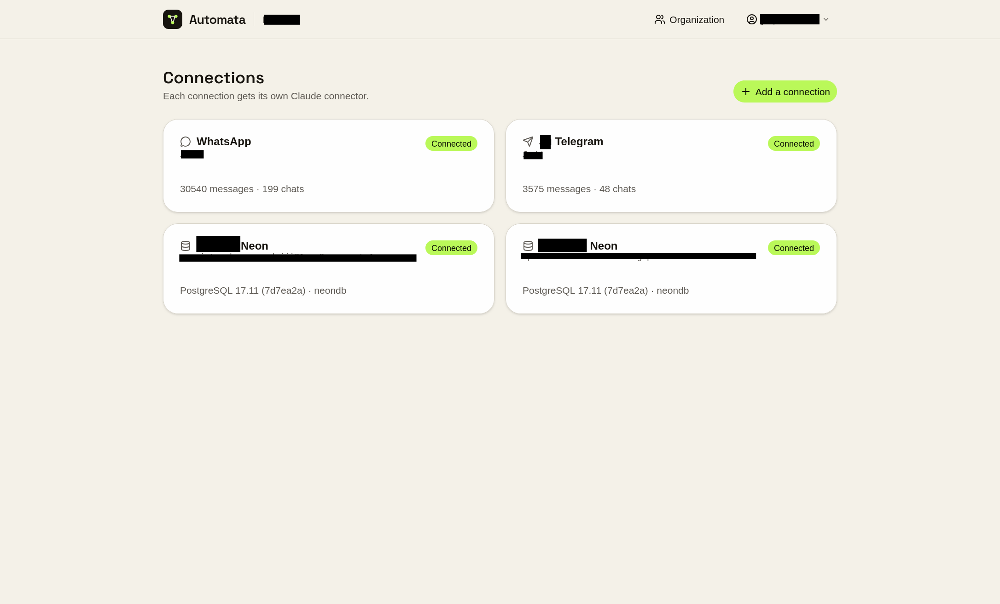
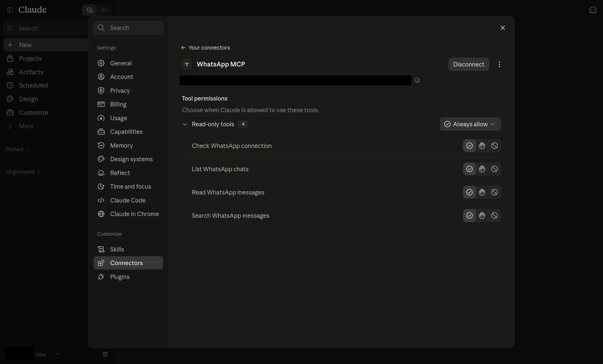

<p align="center">
  <a href="https://getautomata.app">
    <picture>
      <source media="(prefers-color-scheme: dark)" srcset="docs/images/logo-dark.svg">
      
    </picture>
  </a>
</p>

<p align="center">
  <a href="https://getautomata.app">Website</a> ·
  <a href="https://mcp.getautomata.app/signup">Sign up</a> ·
  <a href="https://www.getautomata.app/docs">Documentation</a> ·
  <a href="https://www.getautomata.app/contact">Contact</a>
</p>

<p align="center">
  <a href="https://railway.com/deploy/automata-or-whatsapp-telegram-sql-mcp?referralCode=HxrUPo&utm_medium=integration&utm_source=template&utm_campaign=generic"></a>
</p>

**Automata MCP safely gives Claude (or Codex or any AI Agent) access to your WhatsApp, Telegram, email and PostgreSQL.** Connect an
account or a database once, mint a connector token scoped to the chats or
tables you choose, and paste its URL into Claude as a custom connector. Claude
can then read, search and summarise your conversations, query your data, and —
only if you allow it — send messages and write rows.

Use the hosted version at [mcp.getautomata.app](https://mcp.getautomata.app/signup)
— free for one connection, with a 7-day trial of Pro — or run your own with one
click on Railway or with Docker.

## Screenshots

<p align="center">
  
  <br><em>Today's emails and WhatsApps in one answer: what needs you, and what doesn't.</em>
</p>

<p align="center">
  
  <br><em>Ask about your sales in plain English; tables you didn't share, like payroll, stay out of reach.</em>
</p>

<p align="center">
  
  <br><em>Every connection — WhatsApp, Telegram or PostgreSQL — gets its own Claude connector.</em>
</p>

<p align="center">
  
  <br><em>Added to Claude as a custom connector, with per-tool permissions.</em>
</p>

## Features

- **Four kinds of connection.** A WhatsApp account paired by QR, a Telegram
  account linked by QR, an email mailbox over IMAP, or a PostgreSQL database by
  connection string.
- **Twenty-two MCP tools.** Check status, list chats, read and search
  messages, send text; list, search and read email, fetch attachments and save
  drafts; list and describe tables, run queries and — when granted — write
  statements. See
  [the tool list](docs/using-automata.md#mcp-tools).
- **Your history, not just what arrives next.** WhatsApp history is imported when
  a number is paired; Telegram chats are synced and backfilled.
- **Scoped connector tokens.** Each token reaches exactly one connection, and can
  be narrowed to specific chats, folders, tables and tools. Tokens are
  shown once, stored only as a hash, and can expire, be rotated or be revoked.
- **Read-only databases by default.** Queries run in read-only transactions, one
  statement at a time, checked against the token's table allowlist by inspecting
  the query plan. Writes need the write tool granted explicitly, and roll back if
  they would touch more rows than allowed.
- **Answers Claude can trust.** Every page says when there is more, reactions and
  WhatsApp's control records are filtered and counted, duplicate copies of a
  message are collapsed, and @-mentions are resolved to names.
- **Built for teams.** Organizations with admins and members, email invitations,
  and connections assigned to the people who should use them.
- **Two-factor sign-in.** Authenticator apps, passkeys and security keys, with
  recovery codes. See [two-factor authentication](docs/two-factor.md).
- **Disconnect alerts.** When a WhatsApp or Telegram connection drops, everyone
  who can reach it gets an email — and another when it recovers.
- **Bring your own backend.** Point a connection at your own Evolution API server
  or Telegram bridge instead of the deployment's.

## Quick start

### Hosted

[Sign up at mcp.getautomata.app](https://mcp.getautomata.app/signup) and skip
to [Connect Claude](#connect-claude). Free covers one connection, one connector
token and one user; Pro is $19/month after a 7-day trial, with unlimited
connections and tokens and five users included ($10/user after).

### Railway (one click)

<a href="https://railway.com/deploy/automata-or-whatsapp-telegram-sql-mcp?referralCode=HxrUPo&utm_medium=integration&utm_source=template&utm_campaign=generic"></a>

1. Deploy the template.
2. Open the web service's domain and sign up — the first account is the admin.
3. Optional: set `TELEGRAM_API_ID` / `TELEGRAM_API_HASH` on the bridge for
   Telegram, and the `NUXT_SMTP_*` variables on the web service for email.

Every service and variable is explained in [Deploying to Railway](docs/deploy-railway.md).

### Docker (single container)

```bash
docker run -d --name automata --restart unless-stopped --stop-timeout 30 \
  -p 3000:3000 -v automata_data:/data \
  -e NUXT_PUBLIC_APP_URL=https://automata.example.com \
  ghcr.io/ju-li/automata-mcp-aio:1
```

Postgres, Redis, Evolution API, the web app and the Telegram bridge in one
container; secrets are generated into the volume on first boot. Back up the
volume — see [Single container](docs/self-hosting.md#single-container).

### Docker Compose

```bash
git clone https://github.com/ju-li/automata-mcp.git && cd automata-mcp
cp .env.selfhost.example .env
for k in POSTGRES_PASSWORD WEBHOOK_SECRET EVOLUTION_API_KEY TELEGRAM_BRIDGE_ADMIN_KEY TELEGRAM_SESSION_ENCRYPTION_KEY; do
  echo "$k=$(openssl rand -hex 32)"; done >> .env

docker compose up -d                                         # database connections
docker compose --profile whatsapp up -d                      # + WhatsApp
docker compose --profile whatsapp --profile telegram up -d   # + Telegram
```

Open <http://localhost:3000> and sign up. Set `NUXT_PUBLIC_APP_URL` in `.env` to
the public `https://` address before Claude connects — connector URLs are built
from it. See [Self-hosting](docs/self-hosting.md).

> [!WARNING]
> Pairing binds a real WhatsApp number, and numbers that pair and unpair
> repeatedly can be banned — use a spare SIM. Never run `docker compose down -v`
> or delete the single container's volume: either deletes every paired session.

### Connect Claude

1. Create a connection and pair it, link it, or paste a connection string.
2. On its dashboard, create a **connector token** and choose what it may reach.
3. In Claude, open **Settings → Connectors → Add custom connector** and paste the
   connector URL. For Claude Code: `claude mcp add --transport http <name> <url>`.

## Documentation

- Product documentation: <https://www.getautomata.app/docs>
- Running and developing this repository: [docs/](docs/README.md) —
  [self-hosting](docs/self-hosting.md), [Railway](docs/deploy-railway.md),
  [WhatsApp](docs/whatsapp.md), [Telegram](docs/telegram.md),
  [email](docs/imap.md), [PostgreSQL](docs/postgres.md), [alerts](docs/alerts.md),
  [two-factor](docs/two-factor.md),
  [development](docs/development.md)

## License

[MIT](LICENSE)
